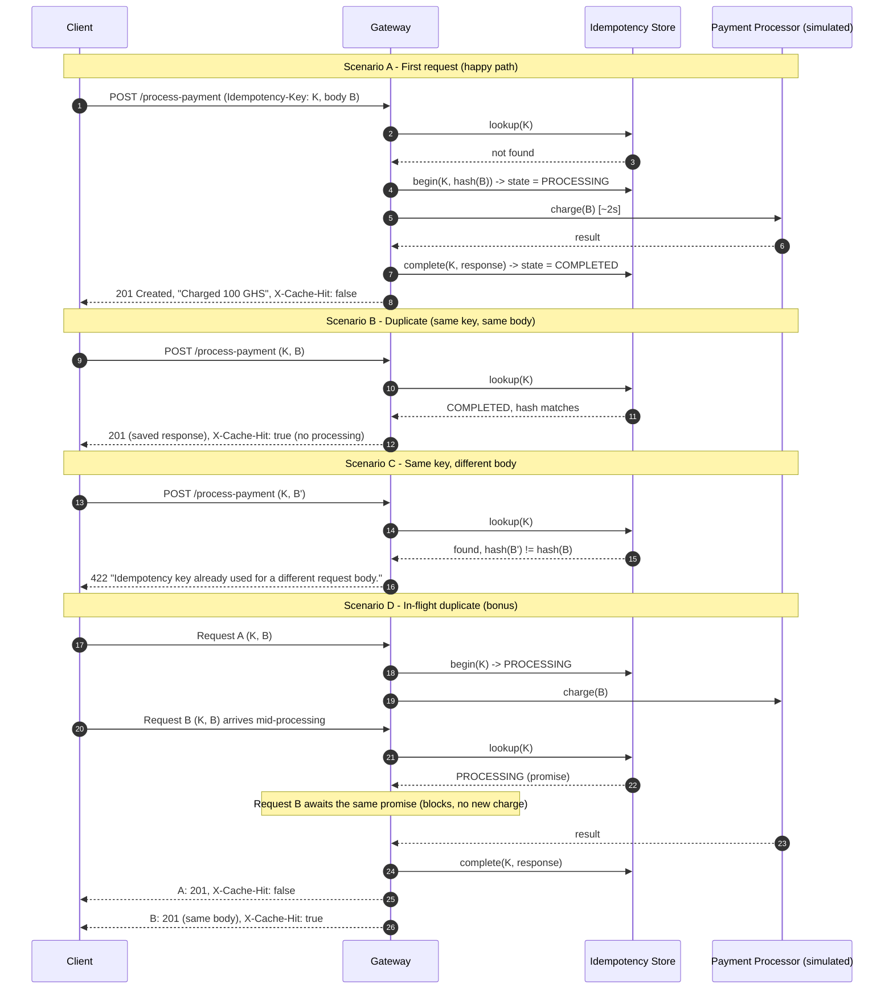
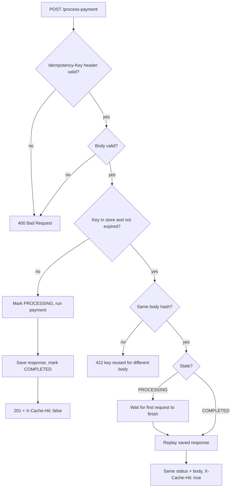

# Idempotency Gateway: the "Pay-Once" Protocol

An idempotency layer for FinSafe Transactions Ltd. No matter how many times a client retries the same payment request, the customer is charged **exactly once**.

- Zero runtime dependencies (Node.js built-ins only), so `npm start` works immediately.
- In-memory store with TTL expiry, in-flight request coalescing, and request-body fingerprinting.

---

## 1. Architecture Diagram

### Sequence diagram (all scenarios)



### Decision flowchart



---

## 2. Setup Instructions

**Requirements:** Node.js 18 or newer. No `npm install` is needed (no dependencies).

```bash
git clone https://github.com/Gikundiroleondrie/AmaliTech-DEG-Project-based-challenges.git
cd AmaliTech-DEG-Project-based-challenges/backend/Idempotency-gateway
npm start          # starts on http://localhost:3000
npm test           # runs the automated test suite
```

**Configuration (optional environment variables)**

| Variable              | Default    | Description                                      |
|-----------------------|------------|--------------------------------------------------|
| `PORT`                | `3000`     | HTTP port                                        |
| `PROCESSING_DELAY_MS` | `2000`     | Simulated payment-processing time                |
| `KEY_TTL_MS`          | `86400000` | How long an idempotency key is remembered (24h)  |

---

## 3. API Documentation

### `POST /process-payment`

| Header            | Required | Description                                                           |
|-------------------|----------|-----------------------------------------------------------------------|
| `Idempotency-Key` | yes      | Unique string, up to 255 chars: letters, digits, `.` `_` `:` `-`      |
| `Content-Type`    | yes      | `application/json`                                                    |

**Body:** `{ "amount": <positive number>, "currency": "<3-letter code>" }`

**First request**
```bash
curl -i -X POST http://localhost:3000/process-payment \
  -H "Content-Type: application/json" \
  -H "Idempotency-Key: order-1001" \
  -d '{"amount": 100, "currency": "GHS"}'
```
```
HTTP/1.1 201 Created
X-Cache-Hit: false

{"status":"Charged 100 GHS","transactionId":"3f0c...","amount":100,"currency":"GHS"}
```

**Duplicate (same key, same body)** returns instantly with the identical body and status code:
```
HTTP/1.1 201 Created
X-Cache-Hit: true

{"status":"Charged 100 GHS","transactionId":"3f0c...","amount":100,"currency":"GHS"}
```

**Same key, different body**
```bash
curl -i -X POST http://localhost:3000/process-payment \
  -H "Content-Type: application/json" -H "Idempotency-Key: order-1001" \
  -d '{"amount": 500, "currency": "GHS"}'
```
```
HTTP/1.1 422 Unprocessable Entity

{"error":"Idempotency key already used for a different request body."}
```

**Status codes**

| Code | Meaning                                                  |
|------|----------------------------------------------------------|
| 201  | Payment processed (or replayed from a previous success)  |
| 400  | Missing/invalid `Idempotency-Key`, invalid JSON or fields|
| 413  | Payload too large                                        |
| 422  | Key already used with a different request body           |
| 500  | Unexpected server error                                  |

### `GET /health`
Returns `{"status":"ok","storedKeys":<n>}`.

---

## 4. Design Decisions

1. **Atomic claim, no locks.** Node is single-threaded, and the `lookup -> begin` sequence has no `await` between its steps. Two simultaneous requests therefore cannot both "win" the key. The loser finds the entry in `PROCESSING` state.
2. **Promise-based in-flight handling.** Each `PROCESSING` entry holds a Promise. A concurrent duplicate simply `await`s it, so it blocks without polling, never returns 409, and never starts a second charge.
3. **Body fingerprinting.** The body is canonicalized (keys sorted) and SHA-256 hashed. `{"amount":100,"currency":"GHS"}` and `{"currency":"GHS","amount":100}` are treated as identical, while any real change yields 422.
4. **Only successes are cached.** If processing throws, the key is released so the client can safely retry, and any waiting duplicates retry too. Validation errors (400) never consume a key.
5. **Exact replay.** The stored status code and body are returned verbatim (including the same `transactionId`), plus `X-Cache-Hit: true`.
6. **Pluggable store.** All state lives behind `IdempotencyStore` (`get / begin / complete / fail / sweep`). For multiple server instances, swap it for Redis (`SET key value NX PX ttl` provides the atomic claim). The HTTP layer would not change.

---

## 5. The Developer's Choice: Key Expiry (TTL) + Key Validation

**What:** Every completed idempotency key expires after a configurable TTL (default 24h, `KEY_TTL_MS`). Expired keys are evicted lazily on access and by a background sweeper. Keys are also validated for length and allowed characters.

**Why:** In a real payment system:
- **Memory safety:** without expiry, the store grows forever, which is a slow-motion outage and a denial-of-service vector.
- **Industry practice:** Stripe and other processors keep keys for about 24 hours. Retries happen within seconds or minutes, so a day-long window covers every realistic retry while letting identical orders later reuse an ID legitimately.
- **Hardening:** bounding key length and charset prevents oversized or malicious keys from bloating memory or logs.

Only `COMPLETED` entries expire, so an in-flight payment can never be evicted mid-processing. This is covered by an automated test.

---

## 6. Project Structure

```
src/
  index.js    # entry point (reads env config, starts server)
  server.js   # HTTP routing, validation, idempotency logic
  store.js    # in-memory store with TTL + in-flight promises
test/
  gateway.test.js   # acceptance tests for every user story
```
